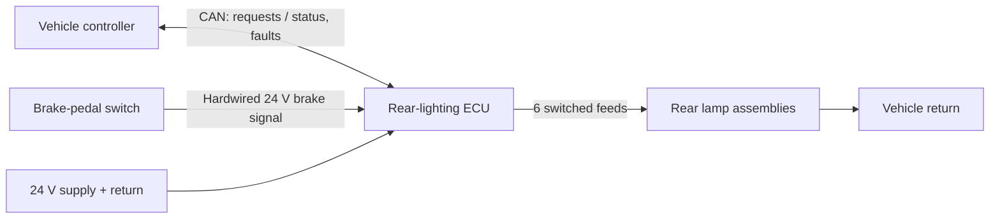
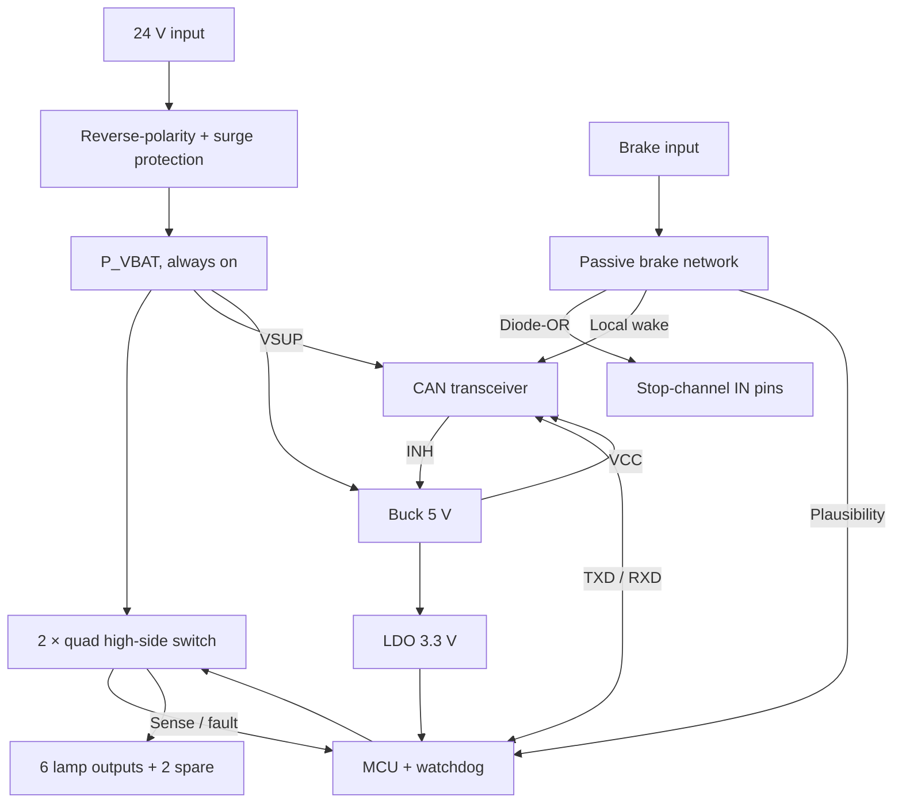

# 01 System Architecture

## Scope

The ECU controls one bus rear-lighting zone with six functions: tail/position, stop and turn, each left and right. It receives lighting requests over CAN and a hardwired brake signal, switches six 24 V lamp feeds, and reports output state and electrical faults.

**Inside the boundary:** input protection, power conversion, MCU, CAN interface, brake-signal input, output switches, output diagnostics.
**Outside the boundary:** lamp optics and LED boards, vehicle-level lighting logic, the dashboard tell-tale. Reverse and rear fog are not designed here, but the two spare output channels (doc 03) are reserved for them.

## System context

The vehicle controller decides which functions are active and drives the turn-indicator tell-tale from the ECU's fault report. The ECU switches locally, monitors each output, and falls back to a defined state when commands are lost (doc 04).

## ECU architecture

Two paths stay alive with the logic rails off: P_VBAT to the switches, and the brake signal to the stop-channel inputs. Everything else wakes through the CAN transceiver's INH output (doc 02).

## Interfaces

| Interface | Definition |
|---|---|
| Supply | 24 V system. Normal operation 18–32 V (ASSUMPTION), 28 V typical. Protection per vehicle transient profile (doc 02) |
| CAN | Lighting requests in; output state and per-channel fault codes out; timeout monitoring per message; remote wake |
| Brake input | 24 V-level signal from the brake-pedal switch; drives the stop channels without logic supply, wakes the ECU, and is read by the MCU for plausibility |
| Lamp outputs | Six independently switched 24 V feeds, common vehicle return; two spare channels |
| Lamp-load interface | Minimum and maximum lamp current and driver topology, stated in the lamp specification (doc 05, LMP-xx) |

## Reference loads

The reference lamp is a HELLA 24 V bus rear lamp (catalogue example, 2007) rated at 0.7 W tail, 5 W stop and 3 W turn. Lamp current depends on the lamp's driver, so the study evaluates three models over 18–32 V:

| Lamp model | Behaviour | Example | Tail range | Stop range |
|---|---|---|---:|---:|
| Resistive | I rises with V | LEDs with series resistor | 21.9–38.9 mA | 156–278 mA |
| Linear | I constant | Linear constant-current driver | 29.2 mA | 208 mA |
| Constant power | I = P / V | Switch-mode LED driver | 21.9–38.9 mA | 156–278 mA |

Peak load with tail + stop + hazard on both sides: **17.4 W, 0.73 A at 24 V**. Every design check uses the full range, not the 24 V value.

## Operating cases

| Case | Active channels |
|---|---|
| Night driving | Tail L+R |
| Braking at night | Tail + stop, L+R |
| Hazard while braking | All six (peak case for current and thermal) |
| CAN lost | Fallback state (doc 04) |
| Parked, brake pressed | ECU wakes; stop lamps light immediately via the passive path |
| Sleep | Outputs off, logic rails off, transceiver on VSUP |

## System requirements

| ID | Requirement |
|---|---|
| SYS-01 | The ECU shall operate across the vehicle's 24 V supply profile, including the specified transients. |
| SYS-02 | The ECU shall switch each of the six lamp functions independently on request. |
| SYS-03 | The ECU shall exchange lighting requests, output state and fault information with the vehicle over CAN. |
| SYS-04 | The ECU shall detect and report lamp and wiring faults on every output. |
| SYS-05 | The ECU shall keep the stop function available when CAN communication, the MCU or the logic supply is lost. |
| SYS-06 | No single ECU-internal fault shall disable both stop lamps or both turn lamps. |
| SYS-07 | The ECU shall stay within its sleep-current allocation when parked and wake on network or brake request. |

These are decomposed into component requirements and traced to tests in doc 05.
