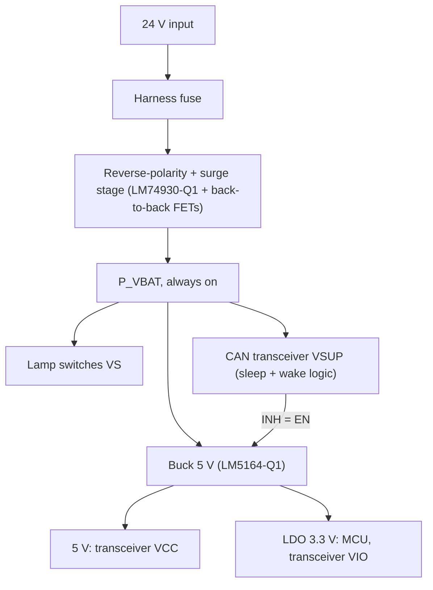

# 02 Power, Wake and Control

## Power architecture

P_VBAT is always on. The logic rails exist only while the ECU is awake, and the CAN transceiver decides when that is.

| Rail | Supplied from | Awake | Asleep |
|---|---|---|---|
| P_VBAT | Battery via protection | On | **On** (switches, transceiver VSUP, front end) |
| 5 V | Buck, enabled by transceiver INH | On | Off |
| 3.3 V | LDO from 5 V | On | Off |

Lamp current never flows through the logic regulators.

## Sleep and wake-up

The TCAN1043A-Q1 has three supply pins, and the design uses all three:

- **VSUP** from P_VBAT powers the transceiver's sleep and wake logic. It is the only part of the CAN interface alive in sleep.
- **VCC** (5 V) powers the bus driver and receiver; it exists only while the buck runs.
- **VIO** (3.3 V) sets the logic level to the MCU.

**Wake sources:**

| Source | Path | Result |
|---|---|---|
| CAN wake-up pattern | Bus → transceiver | INH high → buck on → MCU boots |
| Brake pressed | Brake network → transceiver WAKE pin | Same, and the stop lamps are already lit by the passive path (doc 04) |

**Going to sleep:** the MCU switches all outputs off, disables diagnostics and the OFF-state pull-ups, then puts the transceiver in sleep mode. INH goes low and the buck stops, which removes both logic rails.

**Check to close:** the VSUP pin sees P_VBAT directly, so its absolute-maximum rating must cover the same load-dump level as the switches (below).

## Input protection

### Design input: which load dump applies

| Case (24 V system) | Peak | Source |
|---|---|---|
| Load dump, centrally suppressed (ISO 16750-2 Test B) | **58 V or 65 V** depending on edition / OEM specification | ISO 16750-2; Diotec AN (both values cited) |
| Load dump, unsuppressed (Test A) | 151–202 V, Ri 1–8 Ω, td 100–350 ms | ISO 16750-2 Table 1 |
| Alternator-running supply UA | 28 V | ISO 16750-2 |

**Working assumption:** central load-dump suppression, as is normal for 24 V commercial vehicles. Test A is not applied at the ECU connector.

### Finding: the 65 V rating is not a comfortable margin

The switches (BTT6200-4ESA load-dump rating) and the LM74930-Q1 input are rated 65 V.

| Suppressed level | Headroom to 65 V parts |
|---|---|
| 58 V | +7 V |
| 65 V | **0 V** |

**Decision:** at 58 V, the LM74930-Q1 front end is acceptable after checking its absolute-maximum rating. At 65 V, a local surge stopper must hold P_VBAT at or below 60 V during the pulse, with its MOSFET sized for the pulse energy. This is the first question for the vehicle electrical team.

**Reverse polarity:** the back-to-back MOSFETs block reverse battery. Ideal-diode behaviour avoids the drop and dissipation of a series diode at 0.73 A peak lamp current.

## Logic supply budget

| Rail | Consumer | Allocation |
|---|---|---|
| 3.3 V | MCU incl. CAN controller and ADC | 40 mA (ASSUMPTION) |
| 3.3 V | Temperature sensor, misc. | 2 mA |
| 3.3 V | Switch inputs via 10 kΩ | 1 mA |
| 5 V | CAN transceiver VCC, dominant | 70 mA (ASSUMPTION, replace with datasheet max) |
| **Total** | | **3.3 V: 43 mA; 5 V: 113 mA (0.57 W)** |

- LDO dissipation 5 V → 3.3 V: **73 mW**, so an LDO is kept rather than a second buck.
- Buck input at 80 % efficiency: 0.71 W, **25 mA from 28 V** and 39 mA at 18 V.
- **LM5164-Q1** (6–100 V input, 1 A) has 8.8× current margin. It is chosen for its 100 V input headroom, not its current; a smaller 100 V buck is worth a cost comparison.

## Sleep-current budget (100 µA ECU allocation, ASSUMPTION)

| Contributor | Current |
|---|---|
| 2 × quad switch standby (max, ≤ 85 °C) | 1.0 µA |
| CAN transceiver on VSUP, sleep mode (allocation) | 20 µA |
| Front-end controller (allocation) | 15 µA |
| Buck disabled via INH (allocation) | 5 µA |
| Brake network, brake released (allocation) | 2 µA |
| Dividers and leakage (allocation) | 10 µA |
| OFF-state open-load pull-ups | 0 µA (switched off, doc 03) |
| **Total** | **53 µA, 47 µA margin** |

Six permanent 1.5 kΩ pull-ups would draw 112 mA, more than 1000× the budget, which is why they are switched.

## MCU and CAN

- MCU with integrated CAN controller; TCAN1043A-Q1 transceiver (12/24 V bus capable, ±58 V bus-pin fault rating, sleep/wake with INH and local WAKE input).
- CAN is the only network; LIN is excluded because no endpoint needs it.
- A window watchdog supervises the MCU. During a reset the MCU outputs go low and the switch channels turn off, except the stop channels when the brake is pressed (doc 04).

## References

- ISO 16750-2, *Road vehicles: Electrical loads* (load-dump Test A/B, UA)
- Diotec Semiconductor, *Application Note: Automotive Load Dump Protection* (24 V Table 1 values)
- TI LM74930-Q1, LM5164-Q1, TCAN1043A-Q1 datasheets
- TI TIDA-01167, 12/24 V battery input protection reference design
- TI SNOAAA1, *Protection against unsuppressed load dump in 24 V systems*
