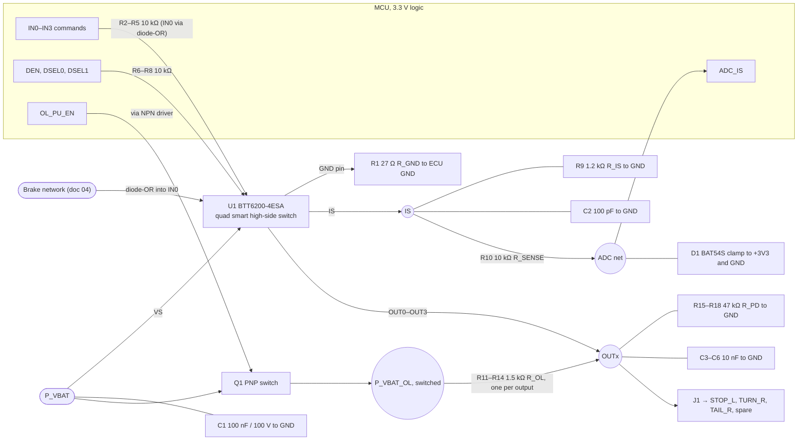

# 03 Output Stage Design

## Device selection

**Selected:** two Infineon BTT6200-4ESA quad smart high-side switches (24 V PROFET+ family) for six channels plus two spares.
**Rejected:** BTT6030-2ERB, the first candidate. It is the same family, but its diagnostics are built for loads around ten times larger than these lamps.

| Property | BTT6030-2ERB (rejected) | BTT6200-4ESA (selected) | Why it matters here |
|---|---|---|---|
| Channels | 2 | 4 | 2 packages instead of 3; 2 spare channels |
| ON-state open-load threshold | 4–25 mA | **5–15 mA** | Tail lamp draws 21.9–38.9 mA (below) |
| Current sense at the lowest spec point | k_ILIS 2450 ± 50 % at 50 mA | k_ILIS 330 ± 50 % at **10 mA** | Spec point inside the lamp-current range |
| Minimum current limit | tens of amps | **9 A** | Closer to what a lamp harness can take |
| R_DS(on) max at 150 °C | 62 mΩ | 400 mΩ | Irrelevant at ≤ 278 mA (below) |
| Load dump / operating range | 65 V / 5–48 V | 65 V / 5–36 V nominal, 48 V extended | Same protection question (doc 02) |

## Finding: the first candidate's diagnostic failed at real operating voltage

The tail lamp's current depends on supply voltage and on the lamp's driver. Against each device's maximum open-load threshold:

| Lamp model | 18 V | 28 V (typical running) | 32 V |
|---|---:|---:|---:|
| Resistive | 21.9 mA | 34.0 mA | 38.9 mA |
| Linear | 29.2 mA | 29.2 mA | 29.2 mA |
| Constant power | 38.9 mA | 25.0 mA | 21.9 mA |

- **BTT6030 (≤ 25 mA):** three cases sit on or below the threshold, the worst 3.1 mA under it. An intact lamp can be reported as open. The ECU cannot override this, because a flagged device saturates its sense output and a real open circuit then looks identical.
- **BTT6200 (≤ 15 mA):** the lowest case (21.9 mA) keeps **+6.9 mA, 1.46×** margin. No case is at risk.

Two other fixes were considered and dropped. An ECU-side bleeder resistor would hide a genuinely open lamp. Requiring a higher lamp current would have pushed a 0.7 W tail lamp toward 1.2 W just to suit the ECU. Changing the switch keeps the reference lamp. The lamp specification still has to guarantee the current the diagnostic relies on: **LMP-01, ≥ 20 mA** (doc 05), which the reference lamp meets at 21.9 mA.

## Channel allocation

| Device | CH0 | CH1 | CH2 | CH3 |
|---|---|---|---|---|
| U1 | STOP_L | TURN_R | TAIL_R | spare (reverse) |
| U2 | STOP_R | TURN_L | TAIL_L | spare (rear fog) |

Rules applied: no device carries both stop lamps, both turn lamps or both tail lamps, and no device carries all the red functions of one side. **If either device fails completely, one stop, one turn and one tail lamp remain.** The spares use the same circuit, so adding reverse and rear fog needs no redesign; the same board can serve vehicle variants with and without them.

## OFF-state diagnostics without lamp glow

The datasheet application circuit uses a 1.5 kΩ pull-up from VS to each output for OFF-state open-load detection. Modelled as a resistor, the tail lamp is about 820 Ω, so the pull-up drives **12.1 mA at 28 V, 35 % of the lamp's ON current**. That is enough to make an LED lamp glow with the output off.

**Decision:** the pull-ups hang on a switched rail (Q1) that is enabled for a window of about 1 ms, at wake-up and periodically while lamps are off. The device's OFF-state sense settles in ≤ 100 µs, so 1 ms is enough. The lamp must tolerate this without visible light (LMP-03).

**Limit stated honestly:** a constant-power LED lamp may not conduct at all through 1.5 kΩ, which leaves the output high and looks like an open load. OFF-state open-load results are therefore used only for lamps whose supplier declares them conductive at that level (LMP-02). For all others, an open lamp is found at its next activation by the ON-state diagnostic. Short-to-battery detection (output high while off, against the 47 kΩ pull-down) works for every lamp type.

## Current-sense chain

| Parameter | Value | Reason |
|---|---|---|
| R_IS | **1.2 kΩ** | Keeps a 0.5 A lamp variant (k_ILIS −11 %) at 2.04 V, below the 3.3 V ADC range; maximum allowed 1.76 kΩ |
| R_SENSE | 10 kΩ | Limits fault-saturation current into the clamp to 2.3 mA per device |
| Clamp | BAT54S to 3.3 V / GND | Keeps saturation current out of the MCU's ESD diodes; the 43 mA rail load absorbs the 4.7 mA back-feed |
| C_SENSE | 100 pF | τ = 120 ns, negligible against the sense settling time |

Signal at the extremes of each lamp's current range (min / typ / max over ± 50 % k_ILIS tolerance):

| Channel | Current | V_IS | Typ. ADC counts |
|---|---:|---:|---:|
| Tail, lowest | 21.9 mA | 53 / 80 / 159 mV | 99 |
| Turn, lowest | 93.8 mA | 227 / 341 / 682 mV | 423 |
| Stop, highest | 277.8 mA | 673 / 1010 / 2020 mV | 1254 |

**What the sense chain can and can't do:** with ± 50 % tolerance it reliably separates a working lamp from an open circuit, but it can't detect one failed LED string in a multi-string lamp. That is stated in ECU-04 and pushed to the lamp in LMP-04. Software reads each device's four channels through DSEL0/DSEL1 (≤ 20 µs channel switch), so all six channels are read well within one turn-indicator flash. k_ILIS is specified at 10 mA and 0.5 A only; the typical value between those points is assumed equal (ASSUMPTION, check against the datasheet curve).

## Fault energy and harness protection

The 9 A minimum current limit is 32× the largest lamp current, so **the switch is still not wiring protection**. Three layers handle a short:

1. The switch's current limit and thermal shutdown protect the switch.
2. Software latches the channel off after 3 retries (ASSUMPTION), so repeated thermal cycling can't stress the harness and connector.
3. The harness fuse and wire gauge, owned by the harness team, protect the wiring.

VT-04 tests the combination.

## Thermal

| Loss per device (U1, worst currents) | Value |
|---|---|
| Lamp conduction, 400 mΩ at 150 °C | 43 mW |
| Device bias, 9 mA × 32 V | 288 mW |
| Total | 331 mW → ΔT_j 13 K at 40 K/W (ASSUMPTION) |
| T_j at 85 °C ambient | **≈ 98 °C** (limit 150 °C) |

Bias current dominates, not the lamps. The package thermal resistance is assumed; VT-06 measures the real board.

## Reference circuit (one output device)

U1 shown; U2 is identical with the allocation above. The brake network into the stop channel (CH0) is detailed in doc 04.

| Ref | Value | Net | Purpose |
|---|---|---|---|
| U1 | BTT6200-4ESA | — | Four high-side channels with diagnostics |
| C1 | 100 nF / 100 V | P_VBAT–GND | Supply spike filtering at VS |
| R1 | 27 Ω | U1 GND–ECU GND | Device overvoltage protection; channels stay off on ground loss |
| R2–R5 | 10 kΩ | MCU–IN0…IN3 | MCU pin protection; reverse-polarity and ground-loss current limiting |
| R6–R8 | 10 kΩ | MCU–DEN, DSEL0, DSEL1 | Same |
| R9 | 1.2 kΩ | IS–GND | Sense resistor (see sense chain) |
| C2 | 100 pF | IS–GND | Sense filtering |
| R10 | 10 kΩ | IS–ADC | Limits fault-saturation current to 2.3 mA |
| D1 | BAT54S | ADC–+3V3 / GND | External clamp |
| Q1 | PNP + NPN driver | P_VBAT–P_VBAT_OL | Pull-ups on only during the diagnostic window |
| R11–R14 | 1.5 kΩ | P_VBAT_OL–OUT0…3 | OFF-state open-load pull-ups |
| R15–R18 | 47 kΩ | OUT0…3–GND | Pull-downs for short-to-battery detection |
| C3–C6 | 10 nF | OUT0…3–GND | ESD and BCI robustness at the connector |

Component values follow the PROFET+ 24 V application-circuit practice; check each against the BTT6200-4ESA English datasheet. ESD protection, layout and connector pinout are not shown.

## References

- Infineon BTT6200-4ESA datasheet (open-load thresholds, current sense, current limit, I_GND)
- Infineon BTT6030-2ERA / -2ERB datasheet (rejected candidate; application circuit)
- HELLA, *Overview Bus* catalogue (2007), reference lamp powers
