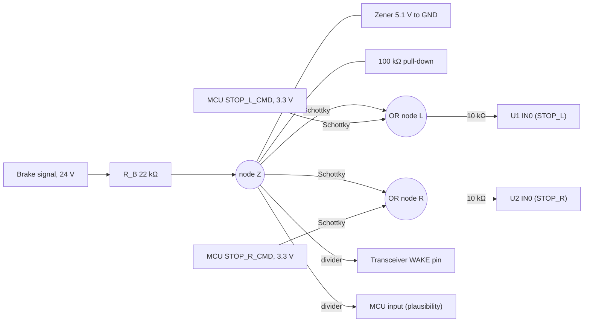

# 04 Safety-Relevant Design Decisions

Safety goals and ASILs come from the OEM's HARA, which this study doesn't have. **Working assumption:** loss of stop-lamp indication during braking is the leading hazard, so no single fault inside the ECU may remove the stop function. All other lamp and wiring faults must be detected and reported. UN R48 also requires the driver to be told about a failed direction indicator (to be verified against the current R48 series), so turn-lamp open-load detection is a homologation requirement.

This document covers only what that assumption changes in the electrical design.

## Passive brake path

The stop channels must light with CAN lost, the MCU in reset, or the logic rails off. The brake signal therefore drives the stop-channel inputs itself, with no logic supply in the path.

| Check | Result |
|---|---|
| Drive level at each OR node | ≈ 4.8 V from the brake (5.1 V zener − 0.3 V); 3.0 V from the MCU. Both to be checked against the switch's V_IN(H) |
| Zener current | 0.59 mA at 18 V, 1.22 mA at 32 V; R_B loss ≤ 33 mW |
| MCU unpowered | The Schottky blocks back-feed from the brake network into the dead MCU pin |
| Wake | The same signal wakes the transceiver, so the MCU boots and starts reporting |
| Sleep current | ≈ 0 with the brake released |

**Trade-off accepted:** a stuck-high brake input lights the stop lamps permanently. The MCU detects this by comparing the input with the CAN brake signal and reports the mismatch. A permanently lit stop lamp is the less severe failure.

## Fallback on CAN timeout

After 500 ms without a valid lighting message (ASSUMPTION):

| Function | Fallback | Rationale |
|---|---|---|
| Tail | ON | Keeps the vehicle visible; lit by day is low severity |
| Stop | Brake input only | Braking stays signalled |
| Turn | OFF | A guessed indication is worse than none; the fault reaches the driver via CAN |

## Single-fault behaviour

| Fault | Effect | Covered by |
|---|---|---|
| One switch device fails completely | One stop, one turn and one tail lamp remain | Channel allocation (doc 03) |
| Lamp or wire open | Reported per channel; turn fault drives the tell-tale | ON-state diagnostic, LMP-01 |
| Output short to GND | Current-limited, latched off after 3 retries, reported | Switch + software + harness fuse |
| Output short to battery / switch stuck on | Reported; the lamp stays lit | OFF-state short-to-battery check |
| Sense resistor open or shorted | Reads full scale or zero → reported as a fault | Fails toward a false report, never a missed fault |
| MCU hang | Watchdog reset; stop lamps stay on the brake path | Passive brake path |
| Brake network fault (e.g. zener short) | Hardware path lost; stop still works via CAN and MCU | Plausibility check reports it |

## Residual risks

1. **Switch stuck on:** there is no second disconnection path, so a stuck channel can only be reported, not switched off. A series disconnect FET per function would fix this; it is left out for cost.
2. **Whole-ECU loss:** supply, ground, connector or PCB failure darkens all six lamps. That is a vehicle-architecture question; the obvious mitigation is feeding the high-mounted stop lamp from a different ECU or supply branch.

**Next step toward a safety case:** once the ASIL is agreed, a quantitative FMEDA of the two switch devices, the brake network and the sense chain, plus a check of the brake-path delay against the fault-tolerant time interval.
